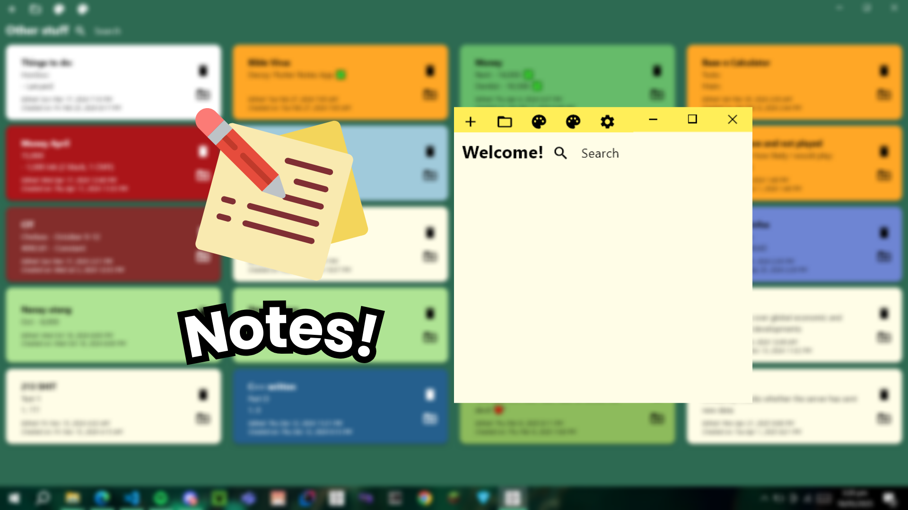

# 📝 Want to take note? Notes! 📝

### Lightweight, stylish, and packed with features. 
Whether its a to-do list, exam pointers, or pasting a funny meme. Notes! got you covered.

## 💾 Installation:

#### 🖥️ Windows
- Download the **Notes!-installer.exe** and run the setup. It is simple and shouldn't take long.

#### 🐧 Linux (Debian / Ubuntu-based)
*Note: These instructions are tested on Linux Mint and should be compatible with other Debian-based distributions.*

- Download the .deb file
- Double-click the downloaded .deb file to open it with the Gdebi Package Installer.
- Click the "Install Package" button and enter your password when prompted.
- Once installed, you can find the application in your Start Menu (usually under the "Office" or "Utilities" category).

## ✨Features!

#### ✨ Rich Text & Images 🌅
- Give your notes some flair with font colors and formatting! Highlight a text and perform `Ctrl + b` for **bold**, `i` for *italic*, and `u` for underline. You can also do `Ctrl + Shift + s` for ~~strikethrough~~.
- Insert (or paste) an image and tap to resize it to your preferred size!

#### 🎨 Colors
- Choose from 10 predefined colors
- Too bland? Click on the **Custom Color** button to edit the **HSV** values to your liking!
- Want even more options? Maximize the screen to show the **Color Wheel, RGB, HSV, HSL, and HEX value**
- Dark mode? Notes! automatically sets the font and icons to black or white depending on the brightness of your chosen color!

#### 📂 Folders
- Want to group notes? No problem. Just click on the folder icon and create a folder, then move the notes to that folder. Easy!

#### 🔄 Reordering
- Newly added notes are added to the top, but don't worry, as Notes! allows you to reorder your notes!
- Simply click and drag your notes to arrange them in the perfect sequence.

#### 💾 Robust Autosaving: Never lose your work again.
- Real-time Debouncing: Saves your note moments after you stop typing, offering near-instant protection against unexpected shutdowns.
- Periodic Backups: Automatically saves all changes every few minutes as a secondary safety net.
- Save on Exit: Guarantees a final save whenever the application is closed or backgrounded.

#### ↔️ Responsive Layout
- On a narrow window, enjoy a clean, scrollable list view.
- Resize the window wider, and it automatically switches to a beautiful grid view to make better use of the space.
  
#### ⚙️ Additional Settings
When you decide to make Notes! app your daily driver, there's a few more options you want to look at.
- **Stay On Top Toggle:** This keeps the window always on top of other applications, helping you focus on creating your notes.
- **Ask Before Deleting:** This allows you to delete notes without having to confirm your decision, increasing your productivity.

#### 🚀 Tech Stack
The app is written in **Dart** using the **Flutter** framework with **Visual Studio Code** as the editor. 
**Hive** is used as the local database and the app is compiled using **Inno Compiler**.  

### 💪 Developer
Built by yours truly 😌🍀
